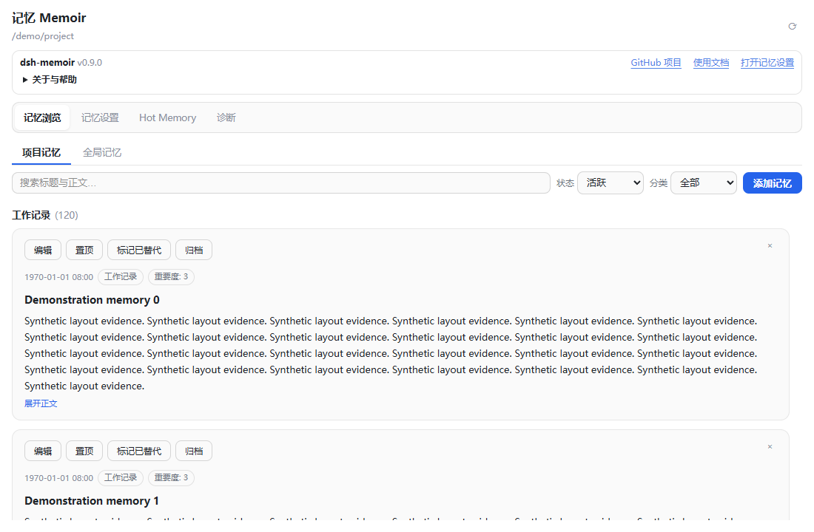
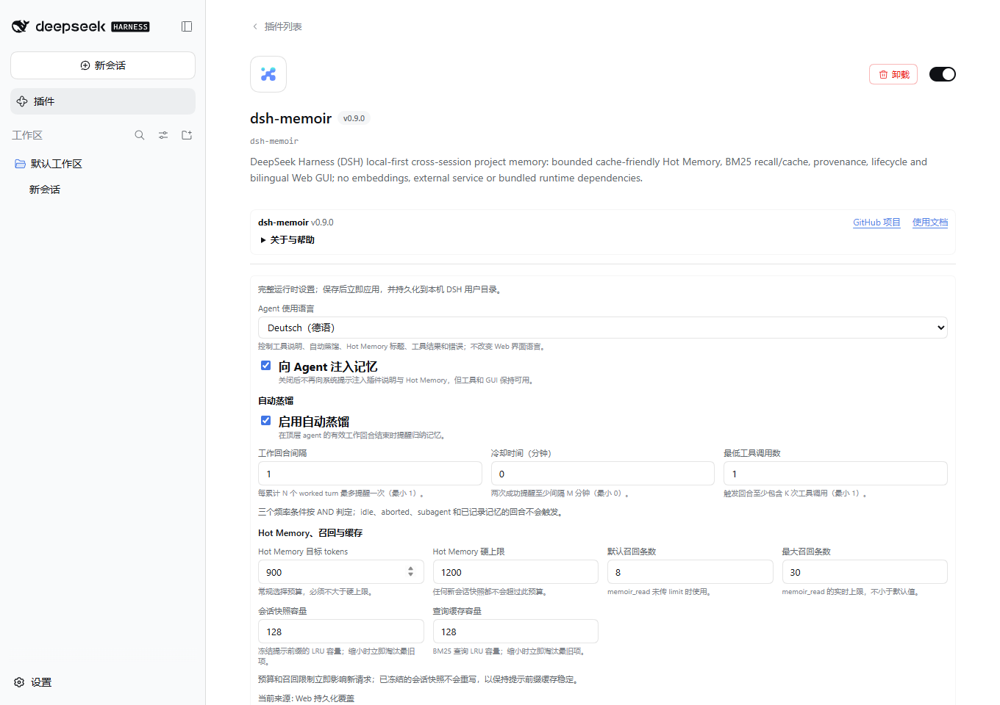
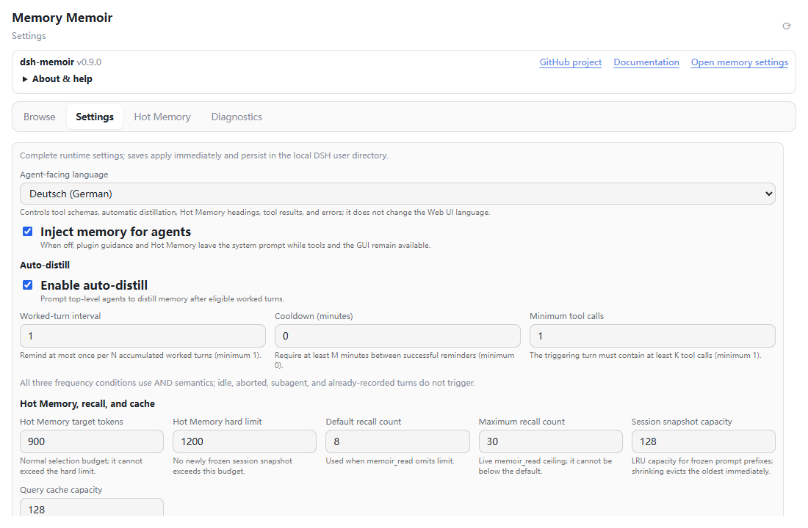

# dsh-memoir

**Help each new agent session pick up your project.** dsh-memoir is a local-first project-memory plugin for DeepSeek Harness (DSH). It persists confirmed work, lessons and next actions, injects bounded Hot Memory into new sessions, and recalls complete history on demand with BM25.

No embeddings, vector database or cloud memory service. The npm package bundles no runtime dependencies; the host supplies DSH and Zod 4 peers. It fits personal and local development workflows, rather than raw chat backups or multi-user cloud sync.

[](https://www.npmjs.com/package/dsh-memoir)
[](https://www.npmjs.com/package/dsh-memoir)
[](./LICENSE)

[中文](./README.md) · English · [Changelog](./CHANGELOG.md) · [Releases](https://github.com/Qinling-Melon-Farmers/dsh-memoir/releases)

## Quick installation

Current release: **0.9.5 (2026-11-06)**, supporting **DSH `0.2.2-rc.1` / Node.js `>=24.9.0`**. This release does not migrate memory, settings or snapshots. Back up DSH_HOME before upgrading; affected historical logs require separate recovery below.

**Web:** install or update the CLI, then add the plugin to the `web` profile:

```sh
npm install --global @deepseek-ai/dsh@0.2.2-rc.1
dsh plugin --profile web add dsh-memoir@0.9.5
```

**Desktop:** check the desktop application's bundled DSH host version first; updating the global CLI does not replace that host. Add the npm package `dsh-memoir@0.9.5` through Desktop's native Plugins manager, or use a CLI pointing to the same DSH_HOME to add it to the `desktop` profile:

```sh
dsh plugin --profile desktop add dsh-memoir@0.9.5
```

Web and Desktop manage plugin installation and activation separately. They share memory and settings files when using the same DSH_HOME and data paths; different homes or machines do not sync automatically. Reload the plugin after installation or upgrade, restarting the relevant `dsh web` or desktop application if needed. Refreshing a page alone does not reload host plugins. If the UI is missing, check the profile and host version first.

## UI preview

These are **historical 0.9.0 previews**, not new 0.9.5 screenshots. Component previews use demonstration data. Plugin information, documentation and memory settings stay at the top.



<details>
<summary>More UI and historical screenshots (original versions retained)</summary>

The native plugin detail page reuses Memory settings. The first image shows the actual DSH 0.2.0-rc.1 host UI; the second is a component preview with German agent copy selected in the English GUI.




Historical sources: [0.9.0 offline notice (demonstration data)](https://raw.githubusercontent.com/Qinling-Melon-Farmers/dsh-memoir/v0.9.0/picture/v0.9.0-announcement-zh.png) · [0.7.1 snapshot diagnostics](https://raw.githubusercontent.com/Qinling-Melon-Farmers/dsh-memoir/v0.7.1/picture/v0.7.1-snapshot-persistence-zh.png) · [0.7.0 native settings](https://raw.githubusercontent.com/Qinling-Melon-Farmers/dsh-memoir/v0.7.0/picture/v0.7.0-dsh015-settings-zh.png) · [0.6.2 distillation diagnostics](https://raw.githubusercontent.com/Qinling-Melon-Farmers/dsh-memoir/v0.6.2/picture/v0.6.2-distill-diagnostics-zh.png).

Earlier sources: [0.6.1 global project groups](https://raw.githubusercontent.com/Qinling-Melon-Farmers/dsh-memoir/v0.6.1/picture/v0.6.1-global-project-groups-zh.png) · [0.6.1 settings navigation](https://raw.githubusercontent.com/Qinling-Melon-Farmers/dsh-memoir/v0.6.1/picture/v0.6.1-settings-navigation-zh.png) · [0.6.1 scrolling layout](https://raw.githubusercontent.com/Qinling-Melon-Farmers/dsh-memoir/v0.6.1/picture/v0.6.1-conversation-scroll-zh.png) · [0.6.0 native view](https://raw.githubusercontent.com/Qinling-Melon-Farmers/dsh-memoir/v0.6.0/picture/v0.6.0-alpha2-native-zh.png) · [0.5.6 memory governance preview](https://raw.githubusercontent.com/Qinling-Melon-Farmers/dsh-memoir/v0.5.6/picture/v0.5.4-memory-management-zh.png) · [0.5.6 settings card](https://raw.githubusercontent.com/Qinling-Melon-Farmers/dsh-memoir/v0.5.6/picture/v0.5.6-settings-card-zh.png) · [0.5.6 sidebar preview](https://raw.githubusercontent.com/Qinling-Melon-Farmers/dsh-memoir/v0.5.6/picture/v0.5.5-sidebar-parity-zh.png). Link tags identify the release source; filenames retain the original component version.

</details>

## Usage, capabilities and boundaries

1. Open Memory in a project conversation or the right sidebar; memory settings are also available from native plugin details or Settings. The sidebar never opens automatically or replaces another panel; other entries remain available without the sidebar service.
2. After working, ask the agent to record conclusions, lessons and next steps, or wait for an eligible distillation reminder. You can also add, edit, pin, archive, restore or supersede entries manually in the panel.
3. Search project or global history in Browse, inspect injection candidates for new sessions in Hot Memory, and check the index, query cache, snapshots and write outcomes in Diagnostics.

### Tools and memory governance

| Tool | Purpose |
| --- | --- |
| `memoir_record` | Record work / lessons / actions / note; return similar or conflicting candidates before writing |
| `memoir_update` | Keep the id and creation time while changing content, section, importance, tags and lifecycle |
| `memoir_read` | Recall within project (default) / global / all: ranked search with a query, recent entries per project without one; compact / full output |

Importance ranges from 1–5, with **3** as the neutral default; pinning adds separate Hot Memory weight. Recall defaults to `active`. Archived and superseded history remains inspectable and restorable, without automatic deletion. Similarity does not establish truth: explicitly choose `update`, history-preserving `supersede`, or `force-record` to keep both. Nothing is merged or deleted automatically.

Project memory stays anchored to the original session project when the execution directory changes. Agent writes retain trusted session/turn provenance, degrading to session-only when necessary. The panel copies identifiers and makes a best-effort jump to the source session, without promising navigation to the exact turn. Manual GUI entries cannot spoof trusted provenance.

### Automatic distillation and language

Automatic distillation is observable, cancelable model work, rather than silent chat scraping or a free background task. Defaults are `1 / 0 / 1`: each eligible worked turn, no extra cooldown, at least one tool call. All three cadence conditions use AND semantics and are isolated per agent. Idle, aborted, subagent and successfully recorded turns are skipped; cooldown advances only after a successful reminder.

Reminders queue a separate wrap-up turn with provenance pointing to the source work turn. They preserve the original task answer's turn boundary, neither advance worked-turn cadence nor trigger recursive distillation, and may increase the displayed turn count. Only persisted `memoir_record` / `memoir_update` calls suppress that turn's reminder; failed calls or unresolved similarity do not count. Turning off `autoDistill` leaves manual write tools available.

Diagnostics distinguish reminders, actual saves, failures, cancellation and unavailable receipts. The host may cancel a result after saving, so counts can overlap. A reminder's correlation with a later save proves neither causation nor content correctness. Manual GUI writes are excluded from Agent-tool counts. Upgrading does not rewrite old folded answers: expand the process disclosure or use `normal` mode to view them. See the [changelog](./CHANGELOG.md) for the fix history.

`language` supports `zh` / `en` / `de` / `ru`, controlling tool descriptions, parameter help, distillation prompts, tool results, validation errors and Hot Memory / Markdown headings. Tool names, parameter keys and enums stay unchanged. It is independent of the Chinese/English GUI, does not infer language or translate existing memories, and affects subsequent prompts immediately without restarting. Switching alone does not rewrite JSON/Markdown; later writes use the selected language for projection headings.

### Hot Memory, recall and the interface

Complete history stays local. Only budgeted actions, lessons and recent state enter the system prompt automatically; the whole Markdown file is never injected. Each session freezes its Hot Memory prefix. New writes are immediately visible to tools and the GUI, while automatic injection refreshes in the next new session. Budget changes do not rewrite existing snapshots. Languages have separate snapshot namespaces, switching back reuses the old baseline, and forks/new session ids do not inherit parent snapshots.

Candidates exceeding the remaining hard budget are skipped in favor of smaller entries. An oversized first entry has its content and, if needed, title shortened against the complete rendered block. If even the minimum block cannot fit, it is skipped; long titles cannot bypass the hard ceiling.

Template literals such as `{{...}}` are emitted verbatim for new memories, cached old snapshots and restored disk snapshots. No snapshot deletion or original-memory rewrite is needed. Frozen prefixes can help caching but do not guarantee provider KV-cache retention, hit rates or billing savings.

BM25 supports Chinese 2/3-grams, Unicode letters/combining marks/numbers and code/path identifiers, with NFC normalization, true term frequency, title boosting and phrase/section/recency weights. The GUI and tools share the BM25 engine and an LRU query cache aware of data updates; different `limit` and output detail values share rankings. The tool takes a global Top-K for `scope=global` with a query. For `scope=all`, it shows the current project first, then merges global results with ID deduplication; the whole call is not guaranteed to be a single global Top-K. Retrieval is lexical, without automatic translation, stemming or cross-language semantic matching.

The UI provides project/global groups, status/section/keyword filters and BM25 scores. It shows batches of 20 entries or projects, with expandable six-line body previews. Browse, Settings, Hot Memory and Diagnostics preserve separate scroll positions, and the final list item stays above the composer. Arrow keys, Home/End, project disclosures and visible focus states are supported. GUI language follows the host's Chinese/English setting.

The first Memory Conversation opening shows offline release highlights without blocking chat. Acknowledging suppresses automatic display for that version in the same UI storage context; reopen from About & help. Settings and sidebar panels do not open it automatically. Without storage, deduplication lasts only for the current page; Web/Desktop acknowledgment need not be shared. Notices make no network requests or memory changes, and the plugin does not automatically check for or install updates.

About & help shows the plugin version, host range, SDK baseline and maintainer. Its links belong to the plugin project, rather than the current workspace repository; it does not inspect workspace Git remotes. Update through the host plugin manager after checking the target package's host requirements and prerelease channel.

See the historical [benchmark report](./bench/report.md). Results vary with corpus and environment and do not guarantee current-version performance, semantic accuracy or billing savings.

## Configuration

Set these parameters in the memoir `config` row of your profile composition; see [cordis.patch.yml](./cordis.patch.yml) for the mounting example. All except `enabled` are also live-editable from the memory panel, Settings or native plugin details, and persist in DSH_HOME.

| Parameter | Default | Purpose |
| --- | ---: | --- |
| `enabled` | `true` | Master switch for tools, routes and prompt injection |
| `language` | `zh` | Agent language: `zh` / `en` / `de` / `ru`, independent of the GUI |
| `announceToAgent` | `true` | Inject memory guidance and Hot Memory; tools and GUI remain available when off |
| `autoDistill` | `true` | Enable top-level worked-turn wrap-up reminders |
| `autoDistillEvery` | `1` | Remind at most once per N eligible worked turns |
| `autoDistillCooldownMin` | `0` | Minimum minutes between successful reminders |
| `autoDistillMinTools` | `1` | Minimum tool calls in the triggering turn |
| `hotMemoryTokens` | `900` | Target Hot Memory token budget for new sessions |
| `hotMemoryMaxTokens` | `1200` | Hard budget ceiling for newly created session snapshots |
| `readDefaultLimit` | `8` | Default `limit` parameter for `memoir_read` |
| `readMaxLimit` | `30` | Live maximum for the `limit` parameter, not a total-output count cap |
| `sessionSnapshotMax` | `128` | In-memory snapshot LRU capacity; does not delete disk snapshots |
| `queryCacheSize` | `128` | BM25 query LRU capacity |

The tool currently applies `limit` separately by branch or project: `scope=all` limits its project and global passes separately, while the global pass without a query limits each project. The total result count can exceed `limit`, subject to the output character budget.

Integer parameters are at least 1, with cooldown at least 0; a hard budget/recall maximum cannot be below its target/default. Shrinking caches immediately evicts the oldest entries. Budget changes affect new snapshots only. Restore startup configuration removes persistent overrides and returns to profile startup values without clearing memory.

## Data safety and recovery

### Files, privacy and backups

DSH_HOME defaults to `~/.dsh`; use the actual configured paths when customized.

| File | Contents |
| --- | --- |
| `$DSH_HOME/dsh-memoir.json` | Complete structured history, JSON store v4, single source of truth |
| `$DSH_HOME/dsh-memoir.settings.json` | Persistent GUI setting overrides, settings v3 |
| `$DSH_HOME/dsh-memoir.json.snapshots/` | Session snapshots loaded on demand, snapshot v1; `<storePath>.snapshots/` when customized |
| `<project>/PROJECT_MEMORY.md` | Readable JSON projection that you may commit to Git |

- The plugin has no separate cloud memory service and makes no additional memory or workspace-path uploads. Content read through tools or injected into prompts enters the current model's context. You decide whether sensitive Markdown belongs in Git.
- Panel memory writes require a trusted active workspace or existing project bucket; submitting an arbitrary absolute path grants no write access. Cross-process memory-store writes take an exclusive lock and reread disk inside it, with conservative dead-writer lock recovery. Settings files lack cross-process refresh and conflict detection; avoid changing settings from multiple hosts at once. Windows path keys are case-normalized while display paths stay unchanged.
- Future store formats, read errors and failed corrupt-file backups fail closed, refusing further loading/overwriting. A fresh store is allowed only after preserving the damaged original. Temporary Windows rename failures receive bounded retries and still surface when exhausted.
- Before upgrades, back up memory JSON, settings, snapshots and project Markdown. Plugin upgrades or removal do not delete them automatically; 0.9.5 does not migrate their formats. DSH session migration is separate: back up all of DSH_HOME, as older hosts may not read migrated sessions.

### Snapshot retention and cleanup

`sessionSnapshotMax` bounds RAM LRU only. Disk snapshots are partitioned by data-source/settings-file hash, language and session hash. They have no automatic TTL and survive shrinking, uninstalling or clearing RAM. To reclaim space, stop relevant DSH processes, back up, then manually remove records you no longer need to resume. Access after deletion establishes a new baseline.

Old sessions whose snapshots are already lost can only establish a baseline from current memory; the plugin never guesses original text from historical system prompts. Corrupt, inaccessible, locked or oversized records remain unchanged, with a process-local frozen fallback and degraded restart stability reported in diagnostics/logs. Text is capped at 256 KiB and each record at 2 MiB. New POSIX directories/files use 0700/0600; Windows uses directory ACLs. Snapshots contain memory text and are user data.

### When an old session will not reopen (#14)

**Invalid receipts written by 0.8.1–0.9.0 can prevent reopening; upgrading Memoir or DSH does not repair historical logs automatically.** Prevention starts in 0.9.1 and is retained in 0.9.5. Template-literal protection does not repair arbitrary old logs either.

Follow the [session recovery guide](./SESSION_RECOVERY.md#english) using the bundled npm `dsh-memoir-repair` command. Stop writes from the affected old plugin and upgrade to a compatible fixed version first. Audit one explicitly named file read-only; only after every Web/CLI/Desktop/background host exits and an independent backup exists, apply explicitly with `--apply --host-stopped`. Disabling automatic distillation alone does not stop manual writes.

Only matching official host/backend/SDK versions in the guide's allowlist are accepted, including `0.2.2-rc.1`. The tool handles active native `session.v4.jsonl[.zstd]` files in header-matching directories only, without home scans or generation migration. It rejects superseded v4, mixed versions, path aliases/links, corruption, mixed encodings and zstd frames without checksums. Stored and expanded size are each capped at 128 MiB.

Apply holds the official session lease with hosts stopped throughout: a same-login-session Windows semaphore or POSIX flock on a stable `session.lock` inode. Use trusted local filesystems, not network drives or cross-login sharing. Only matching legacy receipts gain `ignorable: true`; events, content and order are preserved. Exact original bytes are backed up to `.bak` before same-directory atomic replacement, and repeating makes no change. Windows replacement inherits directory ACLs without preserving custom source-file ACLs. Follow the guide for errors, remaining `.tmp`/`.bak`, `committed: true` and rollback; never delete raw logs, downgrade formats or bulk-delete unknown caches.

## Older-version compatibility

<details>
<summary>Expand host ranges, older plugin lines and upgrade limits</summary>

0.9.5's host/peer range is `>=0.2.0-rc.1 <0.3.0-0 || >=0.2.1-alpha.1 <0.2.1 || >=0.2.2-rc.1 <0.2.2`. It retains official 0.2.0-rc.1 / rc.2 and 0.2.1-alpha.1 / alpha.2 / rc.2 / rc.3 / rc.4 / rc.5 lines. The range does not verify every included or future build and does not admit 0.2.2-alpha. Runtime compatibility does not imply recovery of arbitrary historical logs.

| Pinned Memoir | DSH range | Notes |
| --- | --- | --- |
| `0.9.5` | Range above; development baseline `0.2.2-rc.1` | Current release; memory/settings/snapshot formats unchanged |
| `0.9.4` | `>=0.2.0-rc.1 <0.3.0-0 \|\| >=0.2.1-alpha.1 <0.2.1` | Historical SDK baseline `0.2.1-rc.5`; no 0.2.2-rc.1 adaptation |
| `0.8.2` | `>=0.1.7-rc.1 <0.1.8-0` | Older 0.1.7 line, still affected by #14 |
| `0.7.1` | `>=0.1.5-rc.1 <0.1.6-0` | Older 0.1.5 line; fixes snapshots after restart/RAM eviction |
| `0.6.2` | `>=0.1.2-alpha.2 <0.1.3` | Older 0.1.2 line |
| `0.5.6` | `0.1.1-rc.2` | Older rc.2 line |

Match the plugin version to an older host. Older lines lack all current fixes; back up and upgrade both host and plugin where possible. Select `zh` or `en` before downgrading to 0.8.2. The plugin's Node engine remains `^22.19.0 || >=24.0.0` for older hosts; the current development SDK and DSH 0.2.2-rc.1 still require Node `>=24.9.0`. See the [changelog](./CHANGELOG.md) for full compatibility and fix history.

</details>

## Development and contributing

Development uses official npm DSH SDK `0.2.2-rc.1`, Node `>=24.9.0` and pnpm. See [CONTRIBUTING.md](./CONTRIBUTING.md) for setup, builds and contribution rules, and [cordis.patch.yml](./cordis.patch.yml) for the composition mounting example.

[Source and feedback](https://github.com/Qinling-Melon-Farmers/dsh-memoir) · [Issues](https://github.com/Qinling-Melon-Farmers/dsh-memoir/issues) · [Changelog](./CHANGELOG.md) · [Releases](https://github.com/Qinling-Melon-Farmers/dsh-memoir/releases) · [Apache-2.0](./LICENSE)
