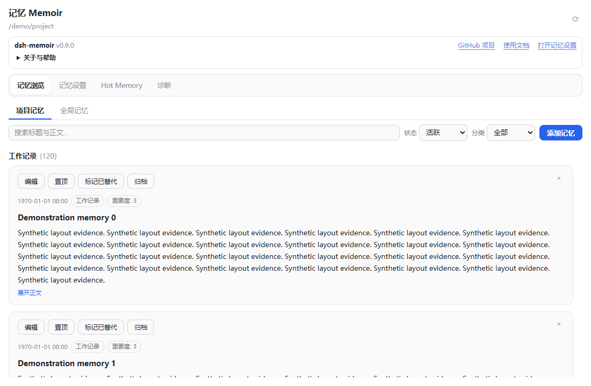
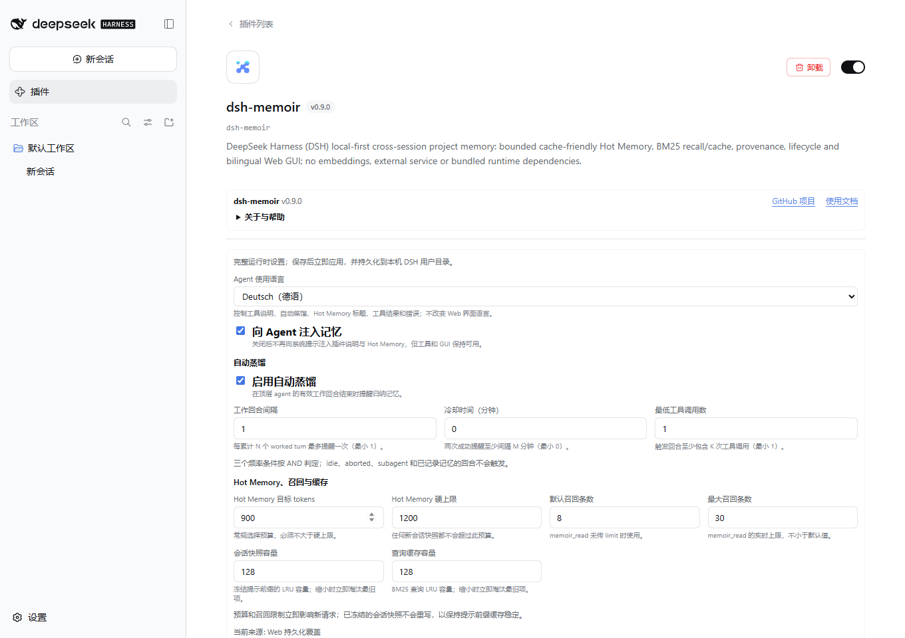
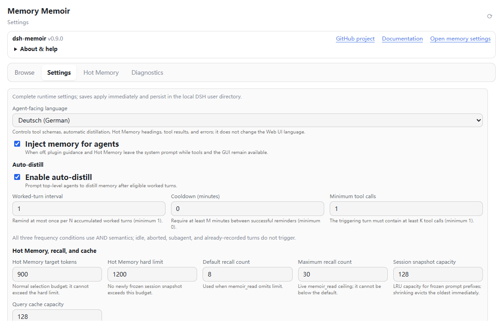

# dsh-memoir

**让新的 Agent 会话继续理解你的项目。** dsh-memoir 是 DeepSeek Harness（DSH）的本地优先项目记忆插件：保存已确认的工作结论、经验教训和后续行动，以有界 Hot Memory 注入新会话，并用 BM25 按需召回完整历史。

无需 embedding、向量数据库或云端记忆服务；npm 包不捆绑运行时依赖，DSH 与 Zod 4 peer 由宿主提供。适合个人和本地开发工作流，不是原始聊天备份或多人云同步服务。

[](https://www.npmjs.com/package/dsh-memoir)
[](https://www.npmjs.com/package/dsh-memoir)
[](./LICENSE)

中文 · [English](./README.en.md) · [更新日志](./CHANGELOG.md) · [Releases](https://github.com/Qinling-Melon-Farmers/dsh-memoir/releases)

## 快速安装

当前版本 **0.9.5（2026-11-06）**，适配 **DSH `0.2.2-rc.1` / Node.js `>=24.9.0`**。本版不迁移记忆、设置或快照；升级前请备份 DSH_HOME。旧日志故障须按后文单独恢复。

**Web：** 安装或更新 CLI，再添加到 `web` profile：

```sh
npm install --global @deepseek-ai/dsh@0.2.2-rc.1
dsh plugin --profile web add dsh-memoir@0.9.5
```

**Desktop：** 先核对桌面应用内置的 DSH 宿主版本；更新全局 CLI 不会替代桌面内置宿主。在桌面的原生「插件」管理界面添加 npm 包 `dsh-memoir@0.9.5`，或用指向同一 DSH_HOME 的 CLI 添加到 `desktop` profile：

```sh
dsh plugin --profile desktop add dsh-memoir@0.9.5
```

Web 与 Desktop 的插件安装、启用分别管理。使用同一 DSH_HOME 和相同数据路径时共享记忆与设置文件；不同 DSH_HOME、不同机器不会自动同步。安装或升级后重新加载插件，必要时重启对应的 `dsh web` 或桌面应用；只刷新页面不足以重新加载宿主插件。界面缺失时先核对 profile 和宿主版本。

## 界面预览

以下是 **0.9.0 历史界面预览**，不是 0.9.5 的新截图。组件预览使用演示数据；插件信息、文档和记忆设置入口常驻顶部。



<details>
<summary>更多界面与历史截图（均保留原版本）</summary>

原生插件详情页直接复用记忆设置。第一张为 DSH 0.2.0-rc.1 的实际宿主界面；第二张为英文 GUI 中选择德语 Agent 文案的组件预览。




历史截图来源：[0.9.0 离线公告（演示数据）](https://raw.githubusercontent.com/Qinling-Melon-Farmers/dsh-memoir/v0.9.0/picture/v0.9.0-announcement-zh.png) · [0.7.1 快照诊断](https://raw.githubusercontent.com/Qinling-Melon-Farmers/dsh-memoir/v0.7.1/picture/v0.7.1-snapshot-persistence-zh.png) · [0.7.0 原生设置](https://raw.githubusercontent.com/Qinling-Melon-Farmers/dsh-memoir/v0.7.0/picture/v0.7.0-dsh015-settings-zh.png) · [0.6.2 蒸馏诊断](https://raw.githubusercontent.com/Qinling-Melon-Farmers/dsh-memoir/v0.6.2/picture/v0.6.2-distill-diagnostics-zh.png)。

更早来源：[0.6.1 全局项目分组](https://raw.githubusercontent.com/Qinling-Melon-Farmers/dsh-memoir/v0.6.1/picture/v0.6.1-global-project-groups-zh.png) · [0.6.1 设置导航](https://raw.githubusercontent.com/Qinling-Melon-Farmers/dsh-memoir/v0.6.1/picture/v0.6.1-settings-navigation-zh.png) · [0.6.1 滚动布局](https://raw.githubusercontent.com/Qinling-Melon-Farmers/dsh-memoir/v0.6.1/picture/v0.6.1-conversation-scroll-zh.png) · [0.6.0 原生视图](https://raw.githubusercontent.com/Qinling-Melon-Farmers/dsh-memoir/v0.6.0/picture/v0.6.0-alpha2-native-zh.png) · [0.5.6 记忆治理预览](https://raw.githubusercontent.com/Qinling-Melon-Farmers/dsh-memoir/v0.5.6/picture/v0.5.4-memory-management-zh.png) · [0.5.6 设置卡](https://raw.githubusercontent.com/Qinling-Melon-Farmers/dsh-memoir/v0.5.6/picture/v0.5.6-settings-card-zh.png) · [0.5.6 侧栏预览](https://raw.githubusercontent.com/Qinling-Melon-Farmers/dsh-memoir/v0.5.6/picture/v0.5.5-sidebar-parity-zh.png)。链接版本为发布来源，文件名保留原组件版本。

</details>

## 如何使用、能力与边界

1. 打开项目会话中的「记忆」，或从右侧栏打开记忆面板；也可在原生插件详情页或设置页进入记忆设置。侧栏不会自动打开或替换其它面板；缺少侧栏服务时其它入口仍可用。
2. 完成工作后，让 Agent「记录本次结论、教训和下一步」，或等待符合条件的自动蒸馏提醒。也可在面板手工新增、编辑、置顶、归档、恢复或替代。
3. 在「记忆浏览」中搜索项目或全局历史，在 Hot Memory 中查看新会话的注入候选，在「诊断」中检查索引、查询缓存、快照和写入结果。

### 工作原理

```text
有效工作回合 -> 自动蒸馏提醒（独立收尾回合）
                         |
                         v
              memoir_record / memoir_update
                         |
                         v
              JSON 记忆库（单一事实源）
                +--> PROJECT_MEMORY.md（可读投影）
                +--> BM25 索引 + 查询 LRU --> memoir_read / GUI 搜索
                `--> Hot Memory Selector --> 会话冻结快照 --> system prompt
```

提醒须满足 AND 门控，是否落盘以工具实际保存结果为准；手动写入不需要先有提醒。BM25 召回与 Hot Memory 选择分别读取结构化记忆，选择器不依赖 BM25 搜索结果。

### 工具与记忆治理

| 工具 | 用途 |
| --- | --- |
| `memoir_record` | 写入 work / lessons / actions / note；写前返回相似或冲突候选 |
| `memoir_update` | 保留 id 和创建时间，修改正文、分类、重要度、标签与生命周期 |
| `memoir_read` | 在 project（默认）/ global / all 范围召回：有查询时按相关度检索，无查询时按项目取近期记录；支持 compact / full 输出 |

重要度为 1–5，默认 **3** 是中性优先级；置顶另有 Hot Memory 权重。默认召回 `active`，归档和被替代的历史仍可检查、恢复，不会自动删除。相似提示不等于判定真伪，必须显式选择 `update`、保留旧历史的 `supersede` 或允许并存的 `force-record`，不会自动合并或删除。

项目记忆绑定会话原始项目，切换执行目录不改变归属。Agent 写入保留可信 session/turn 来源，来源不足时可降级为仅 session；面板可复制标识并尽力打开原会话，不承诺自动定位到具体回合。GUI 手工记录不能伪造可信来源。

### 自动蒸馏与语言

自动蒸馏是可观察、可取消的模型收尾提醒，不是静默抓取聊天或无成本后台任务。默认 `1 / 0 / 1`：每个有效工作回合、无额外冷却、至少一次工具调用；`autoDistillEvery`、`autoDistillCooldownMin`、`autoDistillMinTools` 三个频率条件按 AND 判定、按 Agent 隔离。idle、aborted、subagent 和已成功保存记忆的回合不触发，冷却只在提醒成功后更新。

提醒排入独立收尾回合，来源仍指向原工作回合；不占用原任务答复的回合边界，不计入工作回合频率，也不递归触发蒸馏，可能增加显示的回合数。只有成功保存的 `memoir_record` / `memoir_update` 才抑制本回合提醒；失败或待确认相似候选不算保存。关闭 `autoDistill` 不会关闭手动写入工具。

诊断区分提醒提交、实际保存、失败、取消和回执降级；保存后宿主仍可能取消结果，计数可重叠。提醒与后续保存的关联不证明因果或内容正确，GUI 手工写入不计入 Agent 工具计数。旧版已折叠的答案历史不会被升级改写，须展开过程或使用 `normal` 模式查看；修复历史见[更新日志](./CHANGELOG.md)。

`language` 可选 `zh` / `en` / `de` / `ru`，控制工具描述、参数说明、蒸馏提示、工具结果、校验错误及 Hot Memory / Markdown 标题；工具名、参数名与枚举不变。它与中英 GUI 语言独立，不自动猜测语言或翻译记忆正文。修改即时影响后续提示，无需重启；切换本身不重写 JSON/Markdown，后续写入才使用当前语言的投影标题。

### Hot Memory 与会话快照

- **有界注入**：完整历史保留在本地，只有预算内的 actions、lessons 与 recent state 自动进入 system prompt，不会整份注入 Markdown。
- **冻结前缀**：新写入立即可被工具和 GUI 读取，自动注入从下一新会话更新；预算变更不重写既有快照。语言各有独立快照空间，切回原语言复用旧基线；fork/新 session id 不借用父快照。
- **硬预算处理**：超出剩余预算的候选会被跳过，继续寻找较小条目；首条过大时按完整渲染块缩短正文，必要时缩短标题。最小块仍放不下就跳过，长标题不能突破硬上限。
- **字面量与缓存边界**：`{{...}}` 等模板字面量对新记忆、内存旧快照及磁盘恢复快照均按原文输出，无需删除快照或改写原始记忆。冻结前缀有助缓存，但不保证提供商 KV cache、命中率或账单节省。

### 本地召回与缓存

- **分词**：中文 2/3-gram、Unicode 字母/组合标记/数字及代码/路径标识符；NFC 归一化不修改原始正文，保留德语变音字符与俄语西里尔字母。
- **BM25 排序**：保留真实词频，标题 BM25 分数 **2.5×** 加权，另有精确短语、分类与时间权重；标题与正文独立做长度归一化。
- **共享检索**：GUI 与 `memoir_read` 共用 BM25 引擎。工具 `scope=global` 有查询时取全局 Top-K；`scope=all` 先展示当前项目，再合并全局结果并按 ID 去重，不保证整次调用为统一的全局 Top-K。无查询时按项目取近期记录，`limit` 边界见配置。
- **查询 LRU**：缓存键包含数据 epoch、项目 cwd、分类、状态、归一化查询和 1 小时时间桶，感知数据更新；`limit` 与输出详略不进入键，因此不同输出形态共享排序结果。
- **诊断**：暴露索引、缓存 hits / misses / evictions、命中率及最近一次实际检索耗时。
- **能力边界**：这是词项检索，不提供自动翻译、词形还原或跨语言语义匹配。

### Web / Desktop GUI

- **浏览与治理**：项目/全局记忆分组，状态、分类和关键词筛选，BM25 分数；支持新增、编辑、置顶、归档、恢复与替代。
- **来源**：复制 session/turn 标识并尽力打开原会话，不承诺定位到具体回合。
- **预览与诊断**：Hot Memory Inspector 按当前数据预览新会话候选，不代表已有会话的冻结基线；诊断包括索引、查询缓存、快照及写入结果。
- **长列表**：每批展示 20 条记忆或项目，长正文默认六行，可展开；浏览、设置、Hot Memory、诊断各自保留滚动位置，列表末项避让输入框。
- **可访问性与语言**：支持方向键、Home/End、项目折叠和焦点提示；GUI 跟随宿主中英语言设置，Agent 四语由独立的 `language` 控制。

首次打开记忆会话页展示离线更新摘要，不阻塞对话；确认后同一 UI 存储空间的该版本不再自动展示，可从「关于与帮助」重看。设置页和侧栏不自动弹出；存储不可用时只在当前页面去重，Web/Desktop 确认状态不保证共享。公告不联网或改动记忆，插件不自动检查或升级。

「关于与帮助」显示插件版本、宿主范围、SDK 基线与维护者；链接指向插件项目，不是当前工作区仓库，也不会探测工作区 Git remote。更新通过宿主插件管理器进行，先核对目标包的宿主版本与预发布通道。

历史性能数据见 [benchmark report](./bench/report.md)；结果依语料与环境变化，不代表当前版本的性能、语义准确率或节费保证。

## 配置

以下参数可写入 profile 组合中 memoir 的 `config`（挂载示例见 [cordis.patch.yml](./cordis.patch.yml)）；除 `enabled` 外，也可从记忆面板、设置页或原生插件详情即时修改并持久化到 DSH_HOME。

| 参数 | 默认值 | 作用 |
| --- | ---: | --- |
| `enabled` | `true` | 工具、路由和 prompt 注入总开关 |
| `language` | `zh` | Agent 语言：`zh` / `en` / `de` / `ru`，独立于 GUI |
| `announceToAgent` | `true` | 向 Agent 注入记忆规则与 Hot Memory；关闭后工具和 GUI 仍可用 |
| `autoDistill` | `true` | 启用顶层有效工作回合收尾提醒 |
| `autoDistillEvery` | `1` | 每 N 个有效工作回合最多提醒一次 |
| `autoDistillCooldownMin` | `0` | 两次成功提醒之间的最短分钟间隔 |
| `autoDistillMinTools` | `1` | 触发回合所需最少工具调用数 |
| `hotMemoryTokens` | `900` | 新会话 Hot Memory 目标 token 预算 |
| `hotMemoryMaxTokens` | `1200` | 新建会话快照的硬预算上限 |
| `readDefaultLimit` | `8` | `memoir_read` 默认 `limit` 参数值 |
| `readMaxLimit` | `30` | `limit` 参数的实时上限，非整次调用结果总数上限 |
| `sessionSnapshotMax` | `128` | 内存快照 LRU 容量，不删除磁盘快照 |
| `queryCacheSize` | `128` | BM25 查询 LRU 容量 |

当前工具的 `limit` 按分支或项目分别应用：`scope=all` 的项目与全局部分分别限额，无查询的全局部分则按项目限额，整次调用总数可能超过 `limit`，仍受输出字符预算限制。

整数参数最少为 1，冷却最少为 0；硬预算/召回上限不能小于对应目标/默认值。缩小缓存会立即淘汰最旧项；预算变更只影响新快照。「恢复启动配置」删除持久覆盖并回到 profile 启动值，不清空记忆。

## 数据安全与恢复

### 文件、隐私与备份

默认 DSH_HOME 为 `~/.dsh`；自定义数据路径时以实际配置为准。

| 文件 | 内容 |
| --- | --- |
| `$DSH_HOME/dsh-memoir.json` | 完整结构化历史，JSON store v4，单一事实源 |
| `$DSH_HOME/dsh-memoir.settings.json` | GUI 持久设置覆盖，settings v3 |
| `$DSH_HOME/dsh-memoir.json.snapshots/` | 按需读取的会话冻结快照，snapshot v1；自定义时为 `<storePath>.snapshots/` |
| `<项目>/PROJECT_MEMORY.md` | 从 JSON 生成的可读投影，可由使用者提交 Git |

- 插件无独立云端记忆服务，不额外上传记忆或工作区路径；通过工具读取或注入 prompt 的内容会进入当前模型上下文。是否将敏感 Markdown 提交 Git 由使用者决定。
- 面板记忆写入只接受可信活动工作区或已有项目桶；提交任意绝对路径不授予写权限。记忆库的跨进程写入使用独占锁并在锁内重新读盘，保守回收死亡写者锁；设置文件尚无跨进程刷新与冲突检测，应避免多端同时修改设置。Windows 路径键大小写归一化，展示路径保持原样。
- 未来 store 格式、读取错误或损坏文件备份失败时拒绝继续加载/覆盖；仅成功保存损坏原件后才可新建空库。Windows 临时 rename 失败采用有界重试，耗尽仍报错。
- 升级前备份记忆 JSON、设置、快照目录和项目 Markdown；升级或卸载插件不自动删除它们。0.9.5 不迁移这些格式。DSH 自身会话迁移是另一件事，应备份整个 DSH_HOME；迁移后不保证旧宿主可读。

### 快照保留与清理

`sessionSnapshotMax` 只约束内存 LRU。磁盘快照按数据源/设置文件哈希、语言与会话哈希分开保存，无自动 TTL，不随缩容、卸载或清理内存删除。确需回收时先停止相关 DSH 进程并备份，再人工删除确定不再恢复的记录；再次访问会建立新基线。

快照已丢失的旧会话只能按当前记忆建立一次基线，不从历史 system prompt 猜测原文。损坏、权限、锁或超限错误保留原件并回退到进程内冻结，诊断/日志会报告重启稳定性降级。单条文本上限 256 KiB、记录上限 2 MiB；POSIX 新目录/文件为 0700/0600，Windows 由目录 ACL 管理。快照含记忆文本，应视为用户数据。

### 旧会话打不开（#14）

**0.8.1–0.9.0 写入的异常回执可能导致会话重开失败；升级 Memoir 或 DSH 都不会自动修复旧日志。** 0.9.1 起阻止新增异常回执，0.9.5 保留该修复；模板字面量防护也不修复任意历史日志。

按[会话恢复指南](./SESSION_RECOVERY.md)使用 npm 内置的 `dsh-memoir-repair`：先停止受影响旧插件写入并升级到兼容修复版，针对一个具体文件只读检查；全部 Web/CLI/Desktop/后台宿主退出并独立备份后，才显式 `--apply --host-stopped`。仅关闭自动蒸馏不能阻止手动写入。

只接受指南白名单内版本一致的官方宿主/backend/SDK，含 `0.2.2-rc.1`；仅处理目录与头部匹配的活动原生 `session.v4.jsonl[.zstd]`，不扫描用户目录或迁移代次。拒绝更新格式取代的 v4、混版、路径别名/链接、损坏、混合编码和无校验和 zstd 帧；存储及解压后均最多 128 MiB。

执行须持有官方写锁并持续停机：Windows 为同一登录会话 semaphore，POSIX 为稳定 `session.lock` inode 上的 flock，仅限可信本地文件系统，不用于网络盘或跨登录共享。仅给匹配的旧回执补 `ignorable: true`，不删事件或改正文/顺序；保留原始字节 `.bak` 后同目录原子替换，重复执行无操作。Windows 替换继承目录 ACL，不保留原文件专属 ACL。错误处理、残留 `.tmp`/`.bak`、`committed: true` 与回退按指南处理，不要删除原日志、降级格式或批量删未知缓存。

## 兼容旧版本

<details>
<summary>展开宿主范围、旧兼容线及升级限制</summary>

0.9.5 的宿主/peer 范围为 `>=0.2.0-rc.1 <0.3.0-0 || >=0.2.1-alpha.1 <0.2.1 || >=0.2.2-rc.1 <0.2.2`。保留官方 0.2.0-rc.1 / rc.2 和 0.2.1-alpha.1 / alpha.2 / rc.2 / rc.3 / rc.4 / rc.5 兼容线；范围不代表其中所有或未来构建均已验证，也不放行 0.2.2-alpha。运行兼容不等于任意历史日志可恢复。

| Memoir 固定版本 | DSH 范围 | 注意事项 |
| --- | --- | --- |
| `0.9.5` | 上述范围；开发基线 `0.2.2-rc.1` | 当前版；记忆/设置/快照格式不变 |
| `0.9.4` | `>=0.2.0-rc.1 <0.3.0-0 \|\| >=0.2.1-alpha.1 <0.2.1` | 历史 SDK 基线 `0.2.1-rc.5`，无 0.2.2-rc.1 适配 |
| `0.8.2` | `>=0.1.7-rc.1 <0.1.8-0` | 旧 0.1.7 线，仍受 #14 影响 |
| `0.7.1` | `>=0.1.5-rc.1 <0.1.6-0` | 旧 0.1.5 线，含重启/内存淘汰后快照修复 |
| `0.6.2` | `>=0.1.2-alpha.2 <0.1.3` | 旧 0.1.2 线 |
| `0.5.6` | `0.1.1-rc.2` | 旧 rc.2 线 |

旧宿主须选择对应插件版本；上述旧线不包含当前全部修复，建议备份后一起升级宿主和插件。降到 0.8.2 前先把 Agent 语言改回 `zh` 或 `en`。插件 Node engine 保留 `^22.19.0 || >=24.0.0` 以支持旧宿主；当前开发 SDK 和 DSH 0.2.2-rc.1 仍要求 Node `>=24.9.0`。完整适配与修复历史见[更新日志](./CHANGELOG.md)。

</details>

## 开发与贡献

开发基线为官方 npm DSH SDK `0.2.2-rc.1`，使用 Node `>=24.9.0` 和 pnpm。开发准备、构建及提交规范见 [CONTRIBUTING.md](./CONTRIBUTING.md)；组合挂载示例见 [cordis.patch.yml](./cordis.patch.yml)。

[源码与反馈](https://github.com/Qinling-Melon-Farmers/dsh-memoir) · [Issues](https://github.com/Qinling-Melon-Farmers/dsh-memoir/issues) · [更新日志](./CHANGELOG.md) · [发布记录](https://github.com/Qinling-Melon-Farmers/dsh-memoir/releases) · [Apache-2.0](./LICENSE)
